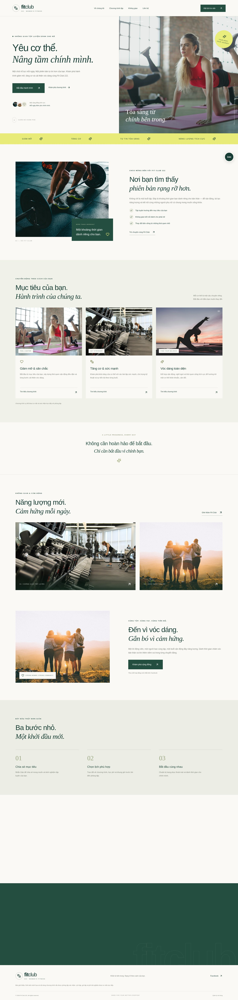

# Fit Club 222

Landing page cho phòng tập nữ tại Tây Nam Linh Đàm. Next.js + TypeScript, sẵn sàng triển khai Vercel và lấy nội dung từ Google Sheets.



- Hero lớn, hiệu ứng xuất hiện khi cuộn, thiết kế kem/xanh/vàng, responsive.
- Chương trình tập, không gian, cộng đồng, lộ trình tham gia, FAQ, liên hệ.
- Zalo, điện thoại, Facebook, bản đồ bằng liên kết thật.
- `/quan-tri`: soạn nháp, xem trước, tải CSV. Không có quyền ghi công khai.
- Google Sheets sidebar: sửa nội dung, chọn ảnh từ máy → Drive, lưu nháp, xuất bản. Cần cài một lần và xác minh bằng tài khoản Google thực tế.
- Ảnh và một phần nội dung đang là minh họa; xem danh sách cần xác nhận trong hướng dẫn.

## Chạy thử

```sh
npm ci
npm run dev
```

## Triển khai

Import repository vào Vercel, framework Next.js. Chạy được ngay bằng dữ liệu mẫu. Khi đã cài Google Sheets, thêm CONTENT_API_URL và GOOGLE_SHEET_EDIT_URL theo `.env.example`, rồi redeploy.

**[Hướng dẫn đầy đủ bằng tiếng Việt](HUONG-DAN.md)** · **[Giao diện mobile](docs/mobile.jpg)**

Đã kiểm tra build production, TypeScript, trình duyệt desktop 1440px/mobile 390px, ảnh, menu, FAQ, Zalo, bản xem trước và xuất CSV. Chưa deploy Vercel, chưa kết nối tài khoản Google.
